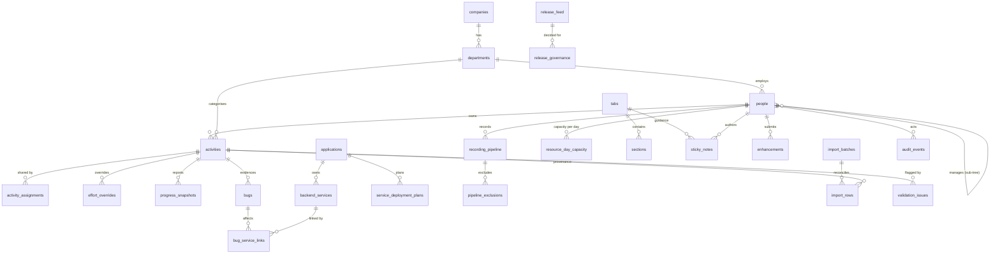

# Data model & ERD

One schema, two drivers. The app runs on **SQLite** (`node:sqlite`, zero native dependencies — the local/dev default) or **Postgres** (`DATABASE_URL`), selected by configuration only; the tables, keys, indices and queries below are identical on both. How the Postgres schema is derived, and how to operate it, is described at the end.

## Core relationships

## Tables

### Organisation & session
| Table | Purpose | Key columns |
| --- | --- | --- |
| `companies` | Legal entity, timezone, fiscal start | `id`, `fiscal_start_month` |
| `departments` | Enable/disable without deletion | `enabled`, `colour`, `sort_order` |
| `people` | Employees, roles, hierarchy, capacity | `manager_id`, `role`, `password_hash`, `capacity_hours_day` |
| `sessions` | Signed-cookie sessions + read-only persona preview | `person_id`, `impersonate_id`, `expires_at` |

### Schedule & work
| Table | Purpose | Notable constraints |
| --- | --- | --- |
| `activities` | Master activity ledger | `CHECK (fte BETWEEN 0 AND 5)`, inclusive dates, `id`/`code` |
| `activity_assignments` | Multi-assignee allocation shares | `UNIQUE(activity_id, person_id)`, `share` 0–1 |
| `effort_overrides` | Explicit per-person/per-date effort | date-only, optional FTE/hours + reason |
| `progress_snapshots` | Point-in-time reported/fixed/closed/outstanding | `as_of` date |
| `bugs` | Defect ledger | `bug_key` unique, linked activity |
| `bug_service_links` | Per-service status, drives derived status | `UNIQUE(bug_id, service_id)` |
| `bug_relations` | Duplicate/related links | `relation` |
| `recording_pipeline` | Recording work items | planned/actual dates, automation %, TEST flag |
| `pipeline_exclusions` | Date exclusions with reason | `pipeline_id` NULL = global |
| `resource_day_capacity` | Four hour categories per person-day | `UNIQUE(person_id, date)` |
| `holidays` | NSW public holidays | `UNIQUE(date, jurisdiction)` |

### Releases
| Table | Purpose |
| --- | --- |
| `release_feed` | Version, self/auto-update, date, link (unverified by default), **QA window** (`qa_start_date`/`qa_end_date`, inclusive, NULL = not planned) and `qa_owner_id` |
| `release_assignees` | People covering a release's QA window, each with a per-working-day FTE share; `UNIQUE(release_id, person_id)`; cascades from both parents |
| `pqu_trains` | Release train, cutoff, duration, raw source text, `flag` |
| `release_governance` | Regression, go/no-go, deployment, decision evidence |
| `applications`, `backend_services` | Inventory used by defects and deployment plans |
| `service_deployment_plans` | Source-parity deployment dates + manual overrides |

### Configuration & content
| Table | Purpose |
| --- | --- |
| `tabs`, `sections` | Stable `tab.*` / `sec.*` IDs with enable flags and minimum role |
| `sticky_notes` | AI guidance per tab/section, authored and timestamped |
| `colour_rules` | Colour dictionary (activity/pipeline/calendar) |
| `settings` | Calculation defaults (FTE, hours/day, fiscal month, visibility) |
| `changelog` | What's New entries with PR references |
| `enhancements` | Enhancement vault records + markdown path + stage/archive + `ai_fields` (which fields were accepted from the assistant) + the GitHub bridge pointer (`source`, `github_repo`, `github_issue_number`, `github_state`, `github_labels`, `github_updated_at`, `github_synced_at`, `github_direction`) |
| `enhancement_links` | Remote objects a proposal points at: its issue and every pull request that names it (`kind`, `number`, `state`, `merged`) |
| `enhancement_sync_events` | Append-only journal of bridge runs: direction, actor, created/updated/skipped counts and per-item errors |
| `ai_summaries` | Reserved for stored AI snapshot summaries (provider + payload) |

### Quality, provenance & audit
| Table | Purpose |
| --- | --- |
| `validation_issues` | Unique per `(entity, entity_id, rule)`; open/acknowledged/resolved |
| `import_batches`, `import_rows` | Dry-run/apply reconciliation with per-row disposition |
| `original_notes_archive` | Verbatim narrative notes from the workbook |
| `audit_events` | Actor, action, entity, before/after JSON, timestamp |

## Indexing notes

- `activities(start_date, end_date)` supports calendar windows and FTE projection.
- `activities(assignee_id)`, `activities(department_id)` support scoped visibility.
- `resource_day_capacity(date)` supports the month pivot.
- `validation_issues` uniqueness enables idempotent re-scans.
- `changelog(date DESC)` and `audit_events(at DESC)` support "latest first" reads.
- `import_rows(batch_id)` supports batch audit.
- `release_feed(qa_start_date, qa_end_date)` and `release_assignees(release_id)` / `(person_id)` support the calendar and FTE projections, which read release windows for a month or a person.
- `release_assignees` is the only release→person link: a release contributes FTE demand through its assignees, never through an activity row.

## Postgres / Neon

Postgres is implemented. `lib/database/postgres.ts` exposes the same synchronous
`all/get/run/exec/transaction` surface as the SQLite driver by running `pg` in a
worker thread and blocking on `Atomics.wait` — the rest of the app never knows
which driver is active.

**Schema delivery.** Migrations stay SQLite-flavoured SQL because that is what
the app writes and what the test suite runs. On a fresh Postgres database the
driver:

1. replays `db/migrations/*.sql` into an in-memory `node:sqlite` engine,
2. reads the resulting schema from `sqlite_master` and emits Postgres DDL
   (types, `DEFAULT` clauses, indices, foreign keys — in dependency order),
3. applies it in one transaction and records `pg-baseline@005_release_planning.sql`
   in `_migrations`.

Migrations written after the baseline are translated statement by statement
(`toPostgres` in `lib/database/dialect.ts`: `?` → `$n`, `datetime('now')` →
`to_char(now() at time zone 'utc', …)`, `INSERT OR IGNORE` → `ON CONFLICT DO
NOTHING`, `LIKE` → `ILIKE`, `IS ?` → `IS NOT DISTINCT FROM ?`, `PRAGMA` dropped,
and a hard error for constructs with no equivalent such as `sqlite_master` or
`rowid`). Because the baseline is generated from the SQLite schema, the two
stores cannot drift into two hand-maintained definitions.

**Operational contract**

- `DATABASE_URL` selects Postgres; without it the SQLite file is used.
- `DATABASE_REQUIRE_POSTGRES=true` turns a connection failure into a startup
  error instead of a silent fallback to a local file.
- `PG_POOL_MAX` bounds connections per process (default 5).
- Inside a transaction all statements run on the reserved client, so a pool of
  one is still correct for migrations and imports.
- `/api/health` reports `driver`, `durable`, `target` (without credentials),
  `baseline` and `fallbackReason`.
- `tests/postgres-driver.test.mts` runs the real driver against Postgres (PGlite
  behind the wire protocol) in CI.

Date-only fields stay `date`-like text on both drivers (`YYYY-MM-DD`), and
timestamps are stored as ISO text so a row written by one driver reads
identically in the other.
