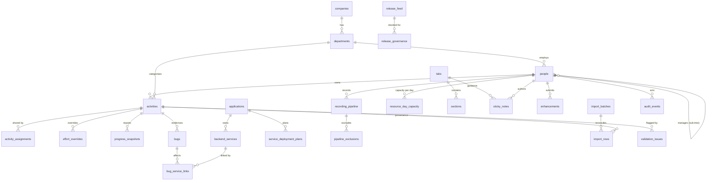

# Data model & ERD

SQLite is used for the runnable reference implementation (zero native dependencies, `node:sqlite`). The schema is portable SQL; the Postgres/Neon migration path is described at the end.

## Core relationships

## Tables

### Organisation & session
| Table | Purpose | Key columns |
| --- | --- | --- |
| `companies` | Legal entity, timezone, fiscal start | `id`, `fiscal_start_month` |
| `departments` | Enable/disable without deletion | `enabled`, `colour`, `sort_order` |
| `people` | Employees, roles, hierarchy, capacity | `manager_id`, `role`, `password_hash`, `capacity_hours_day` |
| `sessions` | Signed-cookie sessions + read-only persona preview | `person_id`, `impersonate_id`, `expires_at` |

### Schedule & work
| Table | Purpose | Notable constraints |
| --- | --- | --- |
| `activities` | Master activity ledger | `CHECK (fte BETWEEN 0 AND 5)`, inclusive dates, `id`/`code` |
| `activity_assignments` | Multi-assignee allocation shares | `UNIQUE(activity_id, person_id)`, `share` 0–1 |
| `effort_overrides` | Explicit per-person/per-date effort | date-only, optional FTE/hours + reason |
| `progress_snapshots` | Point-in-time reported/fixed/closed/outstanding | `as_of` date |
| `bugs` | Defect ledger | `bug_key` unique, linked activity |
| `bug_service_links` | Per-service status, drives derived status | `UNIQUE(bug_id, service_id)` |
| `bug_relations` | Duplicate/related links | `relation` |
| `recording_pipeline` | Recording work items | planned/actual dates, automation %, TEST flag |
| `pipeline_exclusions` | Date exclusions with reason | `pipeline_id` NULL = global |
| `resource_day_capacity` | Four hour categories per person-day | `UNIQUE(person_id, date)` |
| `holidays` | NSW public holidays | `UNIQUE(date, jurisdiction)` |

### Releases
| Table | Purpose |
| --- | --- |
| `release_feed` | Version, self/auto-update, date, link (unverified by default) |
| `pqu_trains` | Release train, cutoff, duration, raw source text, `flag` |
| `release_governance` | Regression, go/no-go, deployment, decision evidence |
| `applications`, `backend_services` | Inventory used by defects and deployment plans |
| `service_deployment_plans` | Source-parity deployment dates + manual overrides |

### Configuration & content
| Table | Purpose |
| --- | --- |
| `tabs`, `sections` | Stable `tab.*` / `sec.*` IDs with enable flags and minimum role |
| `sticky_notes` | AI guidance per tab/section, authored and timestamped |
| `colour_rules` | Colour dictionary (activity/pipeline/calendar) |
| `settings` | Calculation defaults (FTE, hours/day, fiscal month, visibility) |
| `changelog` | What's New entries with PR references |
| `enhancements` | Enhancement vault records + markdown path + stage/archive |
| `ai_summaries` | Reserved for stored AI snapshot summaries (provider + payload) |

### Quality, provenance & audit
| Table | Purpose |
| --- | --- |
| `validation_issues` | Unique per `(entity, entity_id, rule)`; open/acknowledged/resolved |
| `import_batches`, `import_rows` | Dry-run/apply reconciliation with per-row disposition |
| `original_notes_archive` | Verbatim narrative notes from the workbook |
| `audit_events` | Actor, action, entity, before/after JSON, timestamp |

## Indexing notes

- `activities(start_date, end_date)` supports calendar windows and FTE projection.
- `activities(assignee_id)`, `activities(department_id)` support scoped visibility.
- `resource_day_capacity(date)` supports the month pivot.
- `validation_issues` uniqueness enables idempotent re-scans.
- `changelog(date DESC)` and `audit_events(at DESC)` support "latest first" reads.
- `import_rows(batch_id)` supports batch audit.

## Postgres / Neon migration path

The app talks to the database through `lib/db.ts` only. To move to Postgres:

1. Provision Neon (or any managed Postgres) and store the connection string in the secret store (`DATABASE_URL`).
2. Port `db/migrations/001_init.sql`:
   - `INTEGER` enable flags → `boolean` (or keep `smallint` for minimal churn).
   - `TEXT` ISO dates → `date`; timestamps → `timestamptz`.
   - `REAL` → `double precision` or `numeric(10,4)` for hours/FTE.
   - `datetime('now')` → `now()`; `INSERT OR IGNORE` → `ON CONFLICT DO NOTHING`.
   - Add row-level constraints for the same rules (inclusive dates checked in app + DB).
3. Replace `lib/db.ts` with a `pg`-backed implementation exposing the same `all/get/run/transaction/setting` surface (or introduce Prisma with the schema above).
4. Keep the same natural keys (`activities.code`, `recording_pipeline.code`, `people.email`) so imports remain idempotent.
5. Re-run `npm test` against the adapter, then the import dry-run, then compare row counts with the workbook.

Timezone: date-only fields stay `date`; event timestamps use `timestamptz` and render in `Australia/Sydney`.
